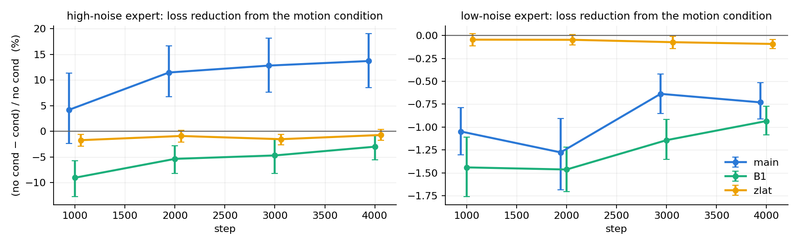

# Poke, Plan, Paint: poke-to-video with ZipMo motion planning on Wan2.2

> **NYCU Image and Video Generation — Final Project**

Given an image and a few **pokes** (arrows saying "this point should be over there in about 4 seconds"), generate
a realistic video that moves as the arrows say. The pipeline has three steps:

- **Poke**: the user draws 1–4 arrows on the first frame.
- **Plan**: a frozen **ZipMo** planner turns the sparse arrows into dense tracks for the whole frame.
- **Paint**: a fine-tuned **Wan2.2-I2V-A14B** renders the video along those tracks.

```
first frame + pokes ──► ZipMo sparse planner (frozen) ──► motion latent z [256×16]
                                                           │ ZipMo VAE decoder
                                                           ▼
                                   dense tracks at the 40×72 latent grid, 64 steps
                                                           │ splat first-frame latent features along the tracks
                                                           ▼
            Wan2.2-I2V-A14B (both experts: LoRA r32 + zero-init motion adapter) ──► 65 frames, 320×576
```

- [Method](#method)
- [Experimental setup](#experimental-setup)
- [Results](#results): [Pexels benchmark](#1-pexels-benchmark-68-clips) · [Training and validation loss](#2-training-and-validation-loss) · [Qualitative](#3-qualitative-results) · [User study](#4-user-study)
- [Conclusions](#conclusions)
- [Reproducing the experiments](#reproducing-the-experiments)
- [Repository layout](#repository-layout)

---

## Method

### Motion planning: ZipMo (frozen)

[ZipMo](https://github.com/CompVis/long-term-motion) (CompVis) is a generative model of point tracks with two
parts:

- **VAE**: compresses the dense point tracks of a video into a motion latent `z ∈ R^{256×16}` and decodes it back
  into tracks from any start points.
- **Sparse planner**: samples `z` from the first frame and a few sparse pokes.

We use both frozen. The VAE decoder produces 64-step tracks at the cell centers of the 40×72 latent grid, which
line up with the 65 video frames.

### Motion injection: hybrid (I3)

See `src/motion_cond.py`. Along each track we move the **first frame's VAE latent features** into every latent
frame, similar to Wan-Move. Each latent frame gets three quantities:

- `feat [16]`: the moved first-frame features
- `disp [2]`: displacement from the start point
- `occ [1]`: coverage

These enter A14B along two paths:

1. `feat` is blended by `occ` into A14B's own 16-channel I2V condition latent `y`:
   `y_f = occ·feat + (1−occ)·y_f` for `f ≥ 1`. This path adds no parameters, and the model understands it from
   the start.
2. `disp + occ` goes through a **zero-init Conv3d** (same 1×2×2 kernel as the patch embedding) whose output is
   added to the patch-embedding output.

`src/motion_cond.py` also implements three other modes: `y` (path 1 only), `add` (the teammate's 5B approach),
and `latent` (zlat, below).

### Training

See `src/train.py`.

- **Teacher forcing**: during training the condition is the clip's own motion. The clip is tracked with
  CoTracker3 and encoded by the ZipMo VAE into `z_gt` (3 per clip, precomputed; one is picked at random each step
  and decoded into tracks). At inference the planner's `z`, sampled from the pokes, takes its place.
- **The two experts are trained separately**:
  - high-noise: `transformer`, σ ∈ [0.9, 1]; decides motion and layout.
  - low-noise: `transformer_2`, σ ∈ [0, 0.9]; fills in detail.
  - 4000 steps per expert, batch size 1, flow-matching loss.
- **Parameters**:
  - LoRA r32 (α 32) on `to_q/k/v/out` of every attention layer, plus the motion adapter; lr 1e-4 for both.
  - Condition dropout 0.1, so motion CFG works at inference.
  - Fixed prompt: "A realistic video shot with a static camera. The objects in the scene move naturally."
- **Cost**: about 18 s/step and 35.5 GB peak on an RTX A6000 (48 GB). One expert takes about 20 hours; a
  checkpoint is 210 MB.

### Inference

See `src/infer.py` and `src/bench_pexels.py render`.

- 30 steps, shift 3.
- **Motion CFG 3.0**: the unconditional branch uses the same prompt and the vanilla condition latent, without the
  adapter, which matches the dropout used in training.
- Planner noise seed 43 (as in ZipMo's official setup); one video per setting (K = 1).

---

## Experimental setup

### Data

The full clip list and sources are in [datasets/](datasets/).

- **Training**: a clean OpenVid-1M set of 2000 clips, each 65 frames at about 12 fps, with a static camera,
  something moving, and no one talking to the camera. 1950 are used for training and 50 are held out. The
  filtering pipeline is in [docs/data_collection.md](docs/data_collection.md) (in Chinese).
  - We compared Koala-36M and OpenVid first. OpenVid's camera is about 7× steadier and ZipMo reconstructs it
    about 20% better, so we switched to OpenVid. Details: [docs/openvid_check.md](docs/openvid_check.md).
- **Evaluation**: ZipMo's official open-domain benchmark, 68 Pexels videos with 40 GT tracks each. None of these
  videos are used in training.

### Compared methods

All fine-tuned models use exactly the same recipe: same data, 4000 steps per expert, LoRA r32, lr 1e-4,
dropout 0.1.

| Name | Condition | Question it answers |
|---|---|---|
| **Main** | dense tracks from the ZipMo planner, hybrid injection (`--mode hybrid`) | our method |
| Vanilla | no fine-tuning; the original Wan2.2-I2V-A14B, which ignores the pokes | how the base model moves on its own |
| B0 | the same fine-tuning without any motion (`--mode none`) | does the gain come just from fine-tuning on OpenVid? |
| B1 | no ZipMo: points within radius 0.12 of a poke's start move along a straight line at constant speed, all other points stay still; same hybrid injection (`--tracks line`) | is ZipMo's planning needed? |
| zlat | no tracks: `z` goes through an MLP into 256 tokens appended to the text tokens for cross-attention (`--mode latent`; port of the teammate's 5B method B, with positions initialized from sin/cos codes of ZipMo's 16×16 grid) | is an implicit z condition enough? |

Two upper-bound references: Main and zlat with the **oracle z**, i.e. the `z` encoded from the 40 GT tracks.

### Metrics

See `src/bench_pexels.py` and `src/vbench_eval.py`.

- **Pokes**: the first n of the 40 GT tracks (start → end), n = 1 and 4.
- **EPE** (lower is better): CoTracker3 tracks the 40 GT start points in the generated video; EPE is the distance
  between each poked point at the last frame and its GT end point, in pixels of the original 1280×720 frame.
- **MSE**: the Mean MSE of ZipMo's official `compute_metrics_atm`, over all 40 tracks, in [0, 128] coordinates.
- **VBench / VBench-I2V**: scored per clip, measuring quality and consistency. FVD is unstable with 68 clips, so
  we do not use it.
- **Statistics**: every difference comes with a **paired bootstrap** over the 68 clips (10k resamples) and a 95%
  CI; `*` marks a CI that excludes 0.

---

## Results

### 1. Pexels benchmark (68 clips)

**Motion following** (EPE in px, lower is better; Δ = difference from Main with 95% CI)

| Method | EPE, 1 poke | Δ vs Main | EPE, 4 pokes | Δ vs Main | MSE, 4 pokes |
|---|---|---|---|---|---|
| Vanilla Wan2.2 | 32.66 | +23.8 [+16.5, +31.9]* | 28.70 | +19.9 [+13.0, +27.6]* | 216.1 |
| B0: fine-tune, no motion | 24.89 | +16.0 [+10.6, +21.8]* | 22.41 | +13.6 [+8.3, +18.8]* | 184.4 |
| B1: straight-line poke | 23.94 | +15.1 [+9.6, +20.8]* | 18.91 | +10.1 [+5.4, +14.8]* | 156.7 |
| zlat: z as cross-attn tokens | 26.59 | +17.7 [+10.3, +27.6]* | 21.89 | +13.1 [+7.9, +18.2]* | 405.6 |
| **Main: hybrid + ZipMo planner** | **8.89** | — | **8.79** | — | **94.2** |
| *Main + oracle z (upper bound)* | 7.36 | −1.5 [−4.7, +1.5] | 6.91 | −1.9 [−5.6, +1.1] | 35.1 |
| *zlat + oracle z (upper bound)* | 26.21 | +17.3* | 21.07 | +12.3* | 395.0 |
| *Static video (first frame repeated)* | 19.56 | +10.7* | 16.30 | +7.5* | 85.5 |
| *ZipMo planner tracks alone (no video model)* | 0.99 | −7.9* | 0.60 | −8.2* | 56.3 |

**Video quality** (VBench, 4 pokes, higher is better; dynamic = fraction of videos that move; `*` = significantly
different from Main)

| Method | dynamic | subject | background | i2v-subject | aesthetic | imaging |
|---|---|---|---|---|---|---|
| Vanilla Wan2.2 | 0.471 | 0.955* | 0.966* | 0.978* | 0.502 | 65.84 |
| B0 | 0.324* | 0.963* | 0.971* | 0.983* | 0.512* | 65.49 |
| B1 | 0.662 | 0.937 | 0.949 | 0.961 | 0.490 | 64.42 |
| zlat | 0.544 | 0.955* | 0.964* | 0.976* | 0.504 | 65.02 |
| **Main** | 0.544 | 0.931 | 0.954 | 0.956 | 0.495 | 65.39 |
| *Real video (GT)* | 0.382* | 0.963* | 0.974* | 0.982* | 0.521* | 65.44 |

The 1-poke tables, all metrics and every CI are in [results/summary.md](results/summary.md). Raw numbers:
`results/bench/*.json` (EPE / MSE) and `results/vbench/*.json` (VBench, with per-clip scores).

**Reading the tables**

- **Main's EPE is about 1/2 to 1/4 of every other method's**, and all differences are significant. It is only
  1.5–1.9 px behind the oracle z, and that CI includes 0: the motion the planner fills in from a single poke is
  already close to giving the real motion directly.
- **Fine-tuning without motion (B0) barely helps.** B0's EPE is even worse than a video that does not move at
  all. Main's gain comes from the motion condition, not from fine-tuning itself.
- **A straight-line poke (B1) is not enough.** It beats B0 somewhat, but objects do not move rigidly along
  straight lines, and every point away from the pokes is forced to stay still. ZipMo's planning brings EPE from
  18.9 down to 8.8.
- **zlat does not use z at all**: even with the oracle z it is about as good as B0. The validation loss below
  shows the same: removing z makes no difference to it.
- **VBench consistency scores trade off against motion.** Subject, background and i2v scores rise the less a
  video moves: B0 moves least (dynamic 0.32) and is the most consistent. Main is about 0.01–0.03 below B0 on
  consistency, not significantly different on imaging quality (4 pokes), and 0.017 lower on aesthetic quality.
  These numbers alone cannot say whether the videos look real, hence the [user study](#4-user-study).

### 2. Training and validation loss

All curves can be redrawn from the saved checkpoints and logs without retraining: `src/val_loss.py`,
`src/plot_loss.py`.


**Training loss** (mean over 100 steps). On the high-noise expert, Main falls below the other methods from about
step 600 and the gap keeps growing. Main and zlat see exactly the same (clip, σ) at every step, so they can be
compared step by step: over the last 1000 steps zlat's loss is **19.4% higher** than Main's (high) and 1.4% lower
(low); see [`train_loss_zlat_vs_main.png`](results/figures/train_loss_zlat_vs_main.png). The low-noise curves are
noisy because the σ range is wide, so each step's loss mostly depends on which σ was drawn.




**Validation loss**: 20 of the 50 held-out clips, each with 2 fixed σ and fixed noise; one checkpoint every 500
steps; step 0 is the original Wan2.2. Dashed lines are the same model with the condition removed.

| step 4000 | high: val loss (vs base) | high: with vs without condition | low: val loss (vs base) | low: with vs without condition |
|---|---|---|---|---|
| base Wan2.2 | 0.1131 | — | 0.0744 | — |
| **Main** | **0.0968 (−14.5%)** | **−13.7% [−19.0, −8.5]** | 0.0739 (−0.7%) | +0.7% |
| B0 | 0.1114 (−1.5%) | — | 0.0728 (−2.2%) | — |
| B1 | 0.1161 (+2.6%) | +3.0% | 0.0743 (−0.2%) | +0.9% |
| zlat | 0.1108 (−2.0%) | +0.7% | 0.0728 (−2.2%) | +0.1% |

- **Only Main actually uses the motion condition on unseen videos.** Without the condition its loss goes back to
  the base level, and the benefit of the condition grows steadily from 4% at step 1000 to 14% at step 4000, with
  no sign of overfitting. Main learns motion information that generalizes, not just how to match the condition
  on training clips.
- B1's straight-line condition hurts on held-out clips; zlat is the same with or without z.
- **The low-noise expert hardly needs the motion condition**: all methods are within 2%, and the condition even
  has a small but consistent negative effect. By σ < 0.9 the motion is largely decided.

### 3. Qualitative results

> 🚧 **To do**: videos will be picked later and placed in `assets/` (GIF / mp4), using our own annotated input
> photos (see [annotate/](annotate/)) and Pexels clips.

| Input + pokes | Vanilla | B0 | B1 | zlat | **Main** |
|---|---|---|---|---|---|
| *(placeholder)* | | | | | |

### 4. User study

> 🚧 **To do**: the website is done ([userstudy/](userstudy/)); data collection has not started.

Design: each trial shows the first frame with the poke arrows and plays **Main vs. another method** (B0 / B1 /
zlat) in sync, left/right randomized. Two forced-choice questions:

- **Motion**: which video's motion better follows the arrows?
- **Realism**: ignoring the arrows, which video looks more like real footage?

24 trials per participant plus 2 attention checks (a real video played forward vs. reversed). We will report
Main's win rate with a Wilson 95% CI and an exact binomial test.

---

## Conclusions

1. **ZipMo planning plus dense-track injection is an effective poke condition.** On 68 Pexels videos, EPE drops
   from 19–25 px (B0 / B1) to about 9 px, close to the oracle upper bound. The validation loss confirms that the
   model really uses the condition on held-out videos.
2. **The planning step matters**: with the same injection, straight-line pokes (B1) do much worse.
3. **The implicit z condition (zlat) does not learn**: with the same training budget, the model ignores the z
   tokens in cross-attention entirely.
4. **The motion condition only helps the high-noise expert.** Dropping it from the low-noise expert is worth
   trying; that experiment has not been run.
5. **Still open**: VBench consistency cannot tell "moves more" from "lower quality"; Main's realism will be judged
   by the user study.

**Limitations and next steps**

- The quantitative evaluation has only 68 clips, with one video per setting (K = 1).
- The prompt is fixed during training, so the text condition is unused. Next experiments: a prompt-only baseline,
  and prompt + our method.
- Possible ablations: zlat with zero / random z; no condition on the low expert at inference.

---

## Reproducing the experiments

### Environment

- Python 3.10, CUDA 12.8.
- Training one expert needs a GPU with ≥ 40 GB. Inference needs about 33 GB; the two experts are swapped between
  CPU and GPU, so about 60 GB of CPU RAM is needed.

```bash
conda create -n p2v python=3.10 -y && conda activate p2v
pip install -r requirements.txt            # torch 2.9.1, diffusers@f6b6a71, peft 0.18, ...
pip install pandas requests matplotlib gdown

# model weights (HF): Wan-AI/Wan2.2-I2V-A14B-Diffusers (~118 GB) and CompVis/ZipMo
export HF_CACHE=/path/to/hf_cache/hub        # lab: /project/YuHsuanLee/hf_cache/hub (already downloaded)
huggingface-cli download Wan-AI/Wan2.2-I2V-A14B-Diffusers --cache-dir $HF_CACHE
huggingface-cli download CompVis/ZipMo --cache-dir $HF_CACHE

# official evaluation code (compute_metrics_atm)
git clone https://github.com/CompVis/long-term-motion && export ZIPMO_REPO=$PWD/long-term-motion

# VBench goes into a separate --target folder so it does not touch the main env
pip install --target envs/vbench_pkgs vbench==0.1.5 dreamsim==0.2.1 pyiqa==0.1.16 openai-clip==1.0.1 \
    open_clip_torch timm easydict ftfy omegaconf
```

The CoTracker3 and ZipMo model code is already in `third_party/`; CoTracker3 weights download on first use.

### 1. Data

Rebuild it as described in [datasets/README.md](datasets/README.md), or in the lab use
`/project/YuHsuanLee/poke_to_video/data/` directly. You end up with:

- `data/clips_a14b_openvid/`: 1950 clips, each with Wan latents, the condition latent and 3 sets of decoded tracks.
- `data/clips_a14b_openvid_test/`: the 50 held-out clips.
- `data/clips_a14b_openvid{,_test}_z.pt`: the z used by zlat.
- `data/bench_pexels/`: the Pexels benchmark.

Then cache the UMT5 embedding of the fixed prompt:

```bash
python src/encode_prompt.py
```

### 2. Training (8 runs, about 20 hours each)

```bash
C="--clips data/clips_a14b_openvid --steps 4000 --save_every 500"
for e in high low; do
  python src/train.py --run openvid_hybrid_$e --expert $e --mode hybrid $C              # Main
  python src/train.py --run openvid_b0_$e     --expert $e --mode none   $C              # B0
  python src/train.py --run openvid_b1_$e     --expert $e --mode hybrid --tracks line $C  # B1
  python src/train.py --run openvid_zlat_$e   --expert $e --mode latent $C              # zlat
done
```

The runs are independent and can go on different GPUs in parallel. After an interruption, add `--resume` to
continue from `ckpt_last.pt`. Checkpoints are written to `outputs/train/<run>/`.

Existing checkpoints in the lab:

- final: `/project/YuHsuanLee/poke_to_video/outputs/train/<run>/ckpt_last.pt`
- intermediate (every 500 steps): `/project2/YuHsuanLee/poke_to_video_ckpt_archive/<run>/`

### 3. Rendering the Pexels benchmark

```bash
ck() { echo outputs/train/openvid_$1_high/ckpt_last.pt outputs/train/openvid_$1_low/ckpt_last.pt; }
python src/bench_pexels.py render --ckpt $(ck hybrid) --cond planner --out outputs/bench/main   # p1 + p4
python src/bench_pexels.py render --ckpt $(ck hybrid) --cond oracle  --out outputs/bench/main
python src/bench_pexels.py render --ckpt $(ck b0)     --cond none    --out outputs/bench/b0
python src/bench_pexels.py render --ckpt $(ck b1)     --cond line    --out outputs/bench/b1
python src/bench_pexels.py render --ckpt $(ck zlat)   --cond planner --out outputs/bench/zlat
python src/bench_pexels.py render --ckpt $(ck zlat)   --cond oracle  --out outputs/bench/zlat
python src/bench_pexels.py render                     --cond none    --out outputs/bench/vanilla
```

About 6 minutes per video, plus about 20 minutes the first time to load both experts.

### 4. Scoring and tables

```bash
B=outputs/bench
python src/bench_pexels.py eval $B/main/planner/p1 $B/main/planner/p4 --out results/bench/main__planner.json
python src/bench_pexels.py eval $B/main/oracle/all --out results/bench/main__oracle.json
python src/bench_pexels.py eval $B/b0/none/all     --out results/bench/b0__none.json
python src/bench_pexels.py eval $B/b1/line/p1 $B/b1/line/p4 --out results/bench/b1__line.json
python src/bench_pexels.py eval $B/zlat/planner/p1 $B/zlat/planner/p4 --out results/bench/zlat__planner.json
python src/bench_pexels.py eval $B/zlat/oracle/all --out results/bench/zlat__oracle.json
python src/bench_pexels.py eval $B/vanilla/none/all --out results/bench/vanilla__none.json
python src/bench_pexels.py static --out results/bench/static.json

VB="env PYTHONPATH=envs/vbench_pkgs python src/vbench_eval.py"
$VB gt --tag gt
$VB $B/main/planner/p1 --tag main_planner_p1;  $VB $B/main/planner/p4 --tag main_planner_p4
$VB $B/main/oracle/all --tag main_oracle;       $VB $B/b0/none/all --tag b0_none
$VB $B/b1/line/p1 --tag b1_line_p1;             $VB $B/b1/line/p4 --tag b1_line_p4
$VB $B/zlat/planner/p1 --tag zlat_planner_p1;   $VB $B/zlat/planner/p4 --tag zlat_planner_p4
$VB $B/zlat/oracle/all --tag zlat_oracle;       $VB $B/vanilla/none/all --tag vanilla_none

python src/summarize.py                     # -> results/summary.md / summary.json
```

### 5. Validation loss and figures

```bash
python src/val_loss.py --expert high        # -> results/val/val_high.jsonl (one GPU per expert, ~3 h)
python src/val_loss.py --expert low
python src/plot_loss.py                     # -> results/figures/*.png (the training-loss part needs logs/)
```

### Running on the lab GPUs

`scripts/` holds the scheduling scripts we actually used. They wait for idle GPUs (`wait_free_gpus.sh`: no
process, < 1 GB used, for ≥ 1 minute) and send scoring to other machines (`run_eval_remote.sh`). Lab paths and
host names are hard-coded, so elsewhere use the commands above.

| Script | What it does |
|---|---|
| `run_openvid_a14b.sh` | data prep, held-out split, training both Main experts, held-out generation |
| `run_b1.sh`, `run_baselines_and_bench.sh`, `run_zlat.sh` | train B1 / B0 / zlat, render the benchmark |
| `run_eval_remote.sh` | EPE and VBench on the 4090s of other machines |
| `continue_after_enospc.sh`, `resume_openvid_a14b.sh`, `rerender_zlat_planner.sh` | resume after interruptions (NAS full, GPU taken) |
| `overfit_test.sh` | overfit test on 8 clips, checking that the condition path can learn |

---

## Repository layout

| Path | Contents |
|---|---|
| `src/common.py` | paths, constants (65 frames, 320×576, latent 16×17×40×72), ZipMo / Wan VAE / UMT5 loaders, crop geometry |
| `src/motion_cond.py` | track splatting, injection modes (`y` / `add` / `hybrid` / `latent`), B1's straight-line tracks |
| `src/train.py`, `src/infer.py` | training one expert; generation (oracle / planner / none) |
| `src/prep_koala.py`, `src/prep_z.py`, `src/encode_prompt.py` | clip → training `.pt`; z for zlat; prompt embedding |
| `src/openvid_*.py`, `src/tracking.py`, `src/pexels_fetch.py` | data collection: OpenVid download, CoTracker3 tracking, filtering |
| `src/dataset_csv.py` | writes [datasets/clips.csv](datasets/clips.csv); rebuilds splits from it |
| `src/bench_pexels.py`, `src/download_pexels.py`, `src/vbench_eval.py`, `src/summarize.py` | Pexels benchmark: download, rendering, EPE / MSE, VBench, tables |
| `src/val_loss.py`, `src/plot_loss.py` | validation loss from checkpoints, figures |
| `src/motion_stats.py`, `src/zipmo_recon_check.py`, `src/vis_clip.py` | data analysis (OpenVid vs Koala), sanity checks |
| [`datasets/`](datasets/) | list and sources of every clip (CSV) |
| [`userstudy/`](userstudy/) | user study website (pairwise, Main vs baselines) |
| [`annotate/`](annotate/) | poke annotation website for our own input photos (qualitative results) |
| [`docs/`](docs/) | plan, data collection, OpenVid check (some in Chinese) |
| `results/` | all numbers (JSON), tables and figures |
| `third_party/` | ZipMo (MIT), CoTracker3 (CC BY-NC 4.0), OpenCV face detector; sources in each `SOURCE.md` |

`data/`, `outputs/` and `logs/` are not tracked by git.

## Acknowledgements and licenses

- [Wan2.2](https://github.com/Wan-Video/Wan2.2) (Apache 2.0)
- [ZipMo / long-term-motion](https://github.com/CompVis/long-term-motion) (MIT)
- [CoTracker3](https://github.com/facebookresearch/co-tracker) (CC BY-NC 4.0)
- [VBench](https://github.com/Vchitect/VBench)
- [OpenVid-1M](https://huggingface.co/datasets/nkp37/OpenVid-1M)
- Pexels benchmark: selected by the ZipMo authors
- Qualitative input photos: Wikimedia Commons; per-image credits in
  [datasets/qualitative_images.csv](datasets/qualitative_images.csv)

The training videos come from YouTube and are for class use only.
