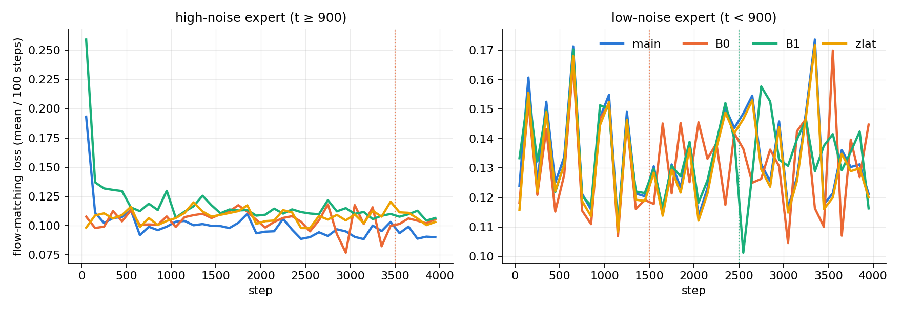
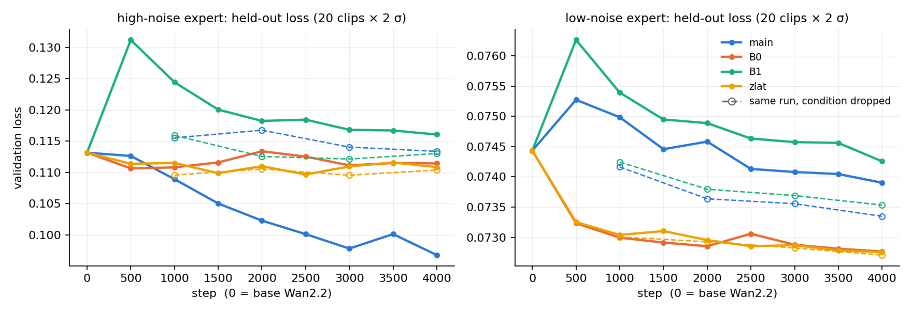

# Poke, Plan, Paint：用 ZipMo 動作規劃控制 Wan2.2 的 poke-to-video

> **NYCU Image and Video Generation — Final Project**

給一張圖和幾個 **poke**（「這一點在約 4 秒後要移到那裡」的箭頭），生成一段照著箭頭動、看起來真實的影片。

做法分三步：

- **Poke**：使用者在第一幀上畫 1–4 個箭頭。
- **Plan**：凍結的 **ZipMo** planner 把稀疏的箭頭補成整張畫面的稠密軌跡。
- **Paint**：微調過的 **Wan2.2-I2V-A14B** 照著軌跡生成影片。

```
first frame + pokes ──► ZipMo sparse planner (frozen) ──► motion latent z [256×16]
                                                           │ ZipMo VAE decoder
                                                           ▼
                                   dense tracks at the 40×72 latent grid, 64 steps
                                                           │ splat first-frame latent features along the tracks
                                                           ▼
            Wan2.2-I2V-A14B (both experts: LoRA r32 + zero-init motion adapter) ──► 65 frames, 320×576
```

- [方法](#方法)
- [實驗設定](#實驗設定)
- [結果](#結果)：[Pexels benchmark](#1-pexels-benchmark68-段) · [訓練與 validation loss](#2-訓練與-validation-loss) · [Qualitative](#3-qualitative-results) · [User study](#4-user-study)
- [結論](#結論)
- [復現](#復現)
- [Repo 結構](#repo-結構)

---

## 方法

### 動作規劃：ZipMo（凍結）

[ZipMo](https://github.com/CompVis/long-term-motion)（CompVis）是一個軌跡生成模型，分成兩部分：

- **VAE**：把一段影片的稠密點軌跡壓成 motion latent `z ∈ R^{256×16}`，也能解回任意起點的軌跡。
- **Sparse planner**：輸入第一幀和稀疏的 poke，取樣出 `z`。

我們整個凍結使用。用 VAE decoder 在 40×72 latent 格點的中心解出 64 步軌跡，對應影片的 65 幀。

### 動作注入：hybrid（I3）

詳見 `src/motion_cond.py`。沿著軌跡把**第一幀的 VAE latent 特徵**搬到每個 latent 幀，做法類似 Wan-Move。每個 latent 幀得到三種量：

- `feat [16]`：搬過去的第一幀特徵
- `disp [2]`：相對起點的位移
- `occ [1]`：覆蓋率

這三種量分兩條路注入 A14B：

1. `feat` 依 `occ` 混進 A14B 原本的 16 通道 I2V condition latent `y`：`y_f = occ·feat + (1−occ)·y_f`，`f ≥ 1`。這一條不需要新參數，模型一開始就看得懂。
2. `disp + occ` 經過 **zero-init Conv3d**（kernel 和 patch embedding 相同，1×2×2），加到 patch embedding 的輸出。

`src/motion_cond.py` 也實作了 `y`（只做第 1 條）、`add`（隊友 5B 版本的做法）、`latent`（見下方 zlat）三種模式。

### 訓練

詳見 `src/train.py`。

- **Teacher forcing**：訓練時的條件是片段自己的動作。先用 CoTracker3 追蹤，再用 ZipMo VAE 編成 `z_gt`，每段預先編 3 個，訓練時隨機取一個，解碼成軌跡。推論時換成 planner 從 poke 取樣的 `z`。
- **兩個 expert 分開訓練**：
  - high-noise：`transformer`，σ ∈ [0.9, 1]，決定動作和構圖。
  - low-noise：`transformer_2`，σ ∈ [0, 0.9]，補細節。
  - 每個 expert 各 4000 步，batch 1，flow matching loss。
- **參數**：
  - LoRA r32（α 32）掛在所有 attention 的 `to_q/k/v/out`；加上 motion adapter。lr 都是 1e-4。
  - condition dropout 0.1，讓推論時可以做 motion CFG。
  - 固定 prompt：「A realistic video shot with a static camera. The objects in the scene move naturally.」
- **成本**：每步約 18 s，峰值 35.5 GB（RTX A6000 48 GB）。一個 expert 約 20 小時，checkpoint 210 MB。

### 推論

詳見 `src/infer.py`、`src/bench_pexels.py render`。

- 30 步，shift 3。
- **Motion CFG 3.0**：uncond 用同一個 prompt、原始的 condition latent、不經過 adapter，和訓練時的 dropout 一致。
- planner 的 noise seed 43，和 ZipMo 官方設定相同；每個設定生成 1 段影片（K = 1）。

---

## 實驗設定

### 資料

完整清單和來源見 [datasets/](datasets/)。

- **訓練**：OpenVid-1M 的 clean set，共 2000 個 65 幀的片段，約 12 fps、鏡頭固定、有物體在動、排除對著鏡頭講話的片段。其中 1950 個訓練，50 個 held-out。篩選流程見 [docs/data_collection.md](docs/data_collection.md)。
  - 我們先比較過 Koala-36M 和 OpenVid：OpenVid 的鏡頭穩定約 7 倍，ZipMo 的重建誤差也低約 20%，所以改用 OpenVid。細節見 [docs/openvid_check.md](docs/openvid_check.md)。
- **評估**：ZipMo 官方 open-domain benchmark，68 段 Pexels 影片，每段 40 條 GT 軌跡。訓練完全沒用到這些影片。

### 比較的方法

四個模型都用完全相同的訓練設定：同一份資料、兩個 expert 各 4000 步、LoRA r32、lr 1e-4、dropout 0.1。

| 名稱 | 條件 | 用來回答的問題 |
|---|---|---|
| **Main** | ZipMo planner 的稠密軌跡，hybrid 注入（`--mode hybrid`） | 我們的方法 |
| Vanilla | 不微調，原始 Wan2.2-I2V-A14B，不吃 poke | 基礎模型本身的動作 |
| B0 | 同樣的微調，但不給動作（`--mode none`） | 進步是不是只是因為在 OpenVid 上微調？ |
| B1 | 不用 ZipMo：poke 起點半徑 0.12 內的點沿直線等速移動，其餘點不動，同樣 hybrid 注入（`--tracks line`） | ZipMo 的規劃有沒有必要？ |
| zlat | 不用軌跡：把 `z` 經過 MLP 變成 256 個 token，接在 text token 後面給 cross-attention（`--mode latent`；隊友 5B method B 的移植，位置用 ZipMo 16×16 格點的 sin/cos 初始化） | 隱式的 z 條件夠不夠？ |

另外兩個上限參考：Main / zlat 搭配 **oracle z**，也就是用 40 條 GT 軌跡編出的 `z`。

### 評估指標

詳見 `src/bench_pexels.py`、`src/vbench_eval.py`。

- **Poke**：40 條 GT 軌跡的前 n 條（起點 → 終點），n = 1、4。
- **EPE**（越低越好）：用 CoTracker3 在生成影片裡追蹤 40 個 GT 起點，計算被 poke 的點在最後一幀和 GT 終點的距離，單位是原始 1280×720 的 px。
- **MSE**：ZipMo 官方 `compute_metrics_atm` 的 Mean MSE，算全部 40 條軌跡，座標在 [0, 128]。
- **VBench / VBench-I2V**：逐片段計分，衡量畫質與一致性。68 段算 FVD 不穩定，所以不用 FVD。
- **統計**：所有差異都對 68 段做 **paired bootstrap**（10k 次），附 95% CI；`*` 表示 CI 不含 0。

---

## 結果

### 1. Pexels benchmark（68 段）

**Motion following**（EPE 單位為 px，越低越好；Δ 是對 Main 的差，附 95% CI）

| 方法 | EPE, 1 poke | Δ vs Main | EPE, 4 pokes | Δ vs Main | MSE, 4 pokes |
|---|---|---|---|---|---|
| Vanilla Wan2.2 | 32.66 | +23.8 [+16.5, +31.9]* | 28.70 | +19.9 [+13.0, +27.6]* | 216.1 |
| B0：微調、不給動作 | 24.89 | +16.0 [+10.6, +21.8]* | 22.41 | +13.6 [+8.3, +18.8]* | 184.4 |
| B1：直線 poke | 23.94 | +15.1 [+9.6, +20.8]* | 18.91 | +10.1 [+5.4, +14.8]* | 156.7 |
| zlat：z 當 cross-attn token | 26.59 | +17.7 [+10.3, +27.6]* | 21.89 | +13.1 [+7.9, +18.2]* | 405.6 |
| **Main：hybrid + ZipMo planner** | **8.89** | — | **8.79** | — | **94.2** |
| *Main + oracle z（上限）* | 7.36 | −1.5 [−4.7, +1.5] | 6.91 | −1.9 [−5.6, +1.1] | 35.1 |
| *zlat + oracle z（上限）* | 26.21 | +17.3* | 21.07 | +12.3* | 395.0 |
| *靜止影片（第一幀重複）* | 19.56 | +10.7* | 16.30 | +7.5* | 85.5 |
| *ZipMo planner 軌跡本身（不經影片模型）* | 0.99 | −7.9* | 0.60 | −8.2* | 56.3 |

**影片品質**：VBench，4 pokes，越高越好；dynamic 是「有在動」的影片比例。`*` 表示和 Main 的差異顯著。

| 方法 | dynamic | subject | background | i2v-subject | aesthetic | imaging |
|---|---|---|---|---|---|---|
| Vanilla Wan2.2 | 0.471 | 0.955* | 0.966* | 0.978* | 0.502 | 65.84 |
| B0 | 0.324* | 0.963* | 0.971* | 0.983* | 0.512* | 65.49 |
| B1 | 0.662 | 0.937 | 0.949 | 0.961 | 0.490 | 64.42 |
| zlat | 0.544 | 0.955* | 0.964* | 0.976* | 0.504 | 65.02 |
| **Main** | 0.544 | 0.931 | 0.954 | 0.956 | 0.495 | 65.39 |
| *真實影片（GT）* | 0.382* | 0.963* | 0.974* | 0.982* | 0.521* | 65.44 |

1 poke 的表格、所有指標和每一格的 CI 見 [results/summary.md](results/summary.md)。原始結果在 `results/bench/*.json`（EPE / MSE）和 `results/vbench/*.json`（VBench，含逐片段分數）。

**怎麼讀這兩張表**

- **Main 的 EPE 只有其他方法的約 1/2 到 1/4**，所有差異都顯著。和 oracle z 只差約 1.5–1.9 px，CI 含 0。也就是說，planner 從 1 個 poke 補出的動作，已經接近直接給真實動作的效果。
- **只微調不給動作（B0）幾乎沒幫助**。B0 的 EPE 甚至比「什麼都不動」的靜止影片還差。所以 Main 的進步來自動作條件，不是來自微調本身。
- **直線 poke（B1）不夠**。它比 B0 好一些，但物體不會照直線剛體移動，而且 poke 以外的點都被強制靜止。ZipMo 的規劃把 EPE 從 18.9 降到 8.8。
- **zlat 完全沒有用到 z**：連 oracle z 都和 B0 差不多。下面的 validation loss 也顯示，拿掉 z 對它沒有影響。
- **VBench 的一致性分數和動作量互相牽制**。subject、background、i2v 這幾項，越不動分數越高：B0 動得最少（dynamic 0.32），一致性就最高。Main 的一致性比 B0 低約 0.01–0.03，但 imaging quality 和 B0 沒有顯著差異（4 pokes），aesthetic 低 0.017。這些數字沒辦法單獨回答「影片看起來真不真實」，所以另外做 [user study](#4-user-study)。

### 2. 訓練與 validation loss

所有曲線都可以從保存的 checkpoint 和 log 重畫，不需要重新訓練：`src/val_loss.py`、`src/plot_loss.py`。



**訓練 loss**（每 100 步平均）。high-noise expert 上 Main 從約 600 步開始就低於其他方法，差距越拉越大。Main 和 zlat 每一步看到的 (clip, σ) 完全相同，可以直接配對比較：最後 1000 步，zlat 的 loss 比 Main 高 **19.4%**（high）、低 1.4%（low），見 [`train_loss_zlat_vs_main.png`](results/figures/train_loss_zlat_vs_main.png)。low-noise 的曲線起伏很大，因為 σ 範圍很寬，每步的 loss 主要由抽到的 σ 決定。




**Validation loss**：用 held-out 50 段中的 20 段，每段固定 2 個 σ 和固定 noise；每 500 步一個 checkpoint；step 0 是原始 Wan2.2。虛線是同一個模型拿掉條件的結果。

| step 4000 | high：val loss（相對 base） | high：有條件 vs 拿掉條件 | low：val loss（相對 base） | low：有條件 vs 拿掉條件 |
|---|---|---|---|---|
| base Wan2.2 | 0.1131 | — | 0.0744 | — |
| **Main** | **0.0968（−14.5%）** | **−13.7% [−19.0, −8.5]** | 0.0739（−0.7%） | +0.7% |
| B0 | 0.1114（−1.5%） | — | 0.0728（−2.2%） | — |
| B1 | 0.1161（+2.6%） | +3.0% | 0.0743（−0.2%） | +0.9% |
| zlat | 0.1108（−2.0%） | +0.7% | 0.0728（−2.2%） | +0.1% |

- **只有 Main 在沒看過的影片上真的用到了動作條件**。拿掉條件後 loss 回到 base 的水準，而且條件帶來的幫助從 1000 步的 4% 穩定成長到 4000 步的 14%，沒有 overfit 的跡象。這表示 Main 學到的是可以推廣的動作資訊，不只是在訓練片段上迎合條件。
- B1 的直線條件在 held-out 上反而有害。zlat 有沒有 z 都一樣。
- **low-noise expert 幾乎不需要動作條件**：各方法差距都小於 2%，條件甚至有一點點小而一致的負面影響。σ < 0.9 時動作已經大致決定了。

### 3. Qualitative results

> 🚧 **待補**：影片之後再挑，會放在 `assets/`（GIF / mp4），用自己標的輸入照片（見 [annotate/](annotate/)）加上 Pexels 片段。

| 輸入 + poke | Vanilla | B0 | B1 | zlat | **Main** |
|---|---|---|---|---|---|
| *(placeholder)* | | | | | |

### 4. User study

> 🚧 **待補**：網站已經完成（[userstudy/](userstudy/)），還沒有開始收資料。

設計：每題顯示第一幀和 poke 箭頭，同步播放 **Main vs. 另一個方法**（B0 / B1 / zlat），左右隨機。受試者回答兩題強制選擇：

- **動作**：哪一部影片的運動比較符合箭頭的指示？
- **真實感**：先不管箭頭，哪一部影片看起來比較像真實拍攝的影片？

每人 24 題，另有 2 題注意力檢查（真實影片正放 vs 倒放）。結果會報告 Main 的勝率、Wilson 95% CI 和 exact binomial test。

---

## 結論

1. **ZipMo planner + 稠密軌跡注入是有效的 poke 條件**。在 68 段 Pexels 影片上，EPE 從 B0 / B1 的 19–25 px 降到約 9 px，接近 oracle 上限。validation loss 也證實模型在 held-out 影片上真的在用這個條件。
2. **規劃這一步不能省**：同樣的注入方式，換成直線 poke（B1）就差很多。
3. **隱式的 z 條件（zlat）學不起來**：在同樣的訓練量下，模型完全忽略 cross-attention 裡的 z token。
4. **動作條件只對 high-noise expert 有用**。low-noise expert 的條件可以考慮拿掉，這個實驗還沒做。
5. **還沒確定的**：VBench 的一致性分數無法分辨「動得多」和「品質差」，Main 的真實感要靠 user study 判斷。

**限制與後續**

- 量化評估只有 68 段，每個設定只生成 1 段影片（K = 1）。
- 訓練時 prompt 固定，沒有發揮 text 條件。下一步的實驗：只用 prompt 的 baseline，以及 prompt + 我們的方法。
- 可以補的 ablation：zlat 換成 zero / random z；推論時 low expert 不吃條件。

---

## 復現

### 環境

- Python 3.10、CUDA 12.8。
- 訓練一個 expert 需要一張 ≥ 40 GB 的 GPU；推論約 33 GB，兩個 expert 輪流放在 CPU 和 GPU 之間，CPU RAM 需要約 60 GB。

```bash
conda create -n p2v python=3.10 -y && conda activate p2v
pip install -r requirements.txt            # torch 2.9.1, diffusers@f6b6a71, peft 0.18, ...
pip install pandas requests matplotlib gdown

# 模型權重 (HF)：Wan-AI/Wan2.2-I2V-A14B-Diffusers（約 120 GB）、CompVis/ZipMo
export HF_CACHE=/path/to/hf_cache/hub        # 實驗室：/project/YuHsuanLee/hf_cache/hub（已下載）
huggingface-cli download Wan-AI/Wan2.2-I2V-A14B-Diffusers --cache-dir $HF_CACHE
huggingface-cli download CompVis/ZipMo --cache-dir $HF_CACHE

# 官方評估程式 (compute_metrics_atm)
git clone https://github.com/CompVis/long-term-motion && export ZIPMO_REPO=$PWD/long-term-motion

# VBench 另外裝在一個 --target 資料夾，不汙染主環境
pip install --target envs/vbench_pkgs vbench==0.1.5 dreamsim==0.2.1 pyiqa==0.1.16 openai-clip==1.0.1 \
    open_clip_torch timm easydict ftfy omegaconf
```

CoTracker3 和 ZipMo 的模型程式碼已經放在 `third_party/`。CoTracker3 的權重第一次使用時會自動下載。

### 1. 資料

照 [datasets/README.md](datasets/README.md) 重建，或在實驗室直接用 `/project/YuHsuanLee/poke_to_video/data/`。重建後會得到：

- `data/clips_a14b_openvid/`：1950 段，每段是 Wan latent、condition latent 和 3 組解碼後的軌跡。
- `data/clips_a14b_openvid_test/`：50 段 held-out。
- `data/clips_a14b_openvid{,_test}_z.pt`：zlat 用的 z。
- `data/bench_pexels/`：Pexels benchmark。

接著快取固定 prompt 的 UMT5 embedding：

```bash
python src/encode_prompt.py
```

### 2. 訓練（8 個 run，每個約 20 小時）

```bash
C="--clips data/clips_a14b_openvid --steps 4000 --save_every 500"
for e in high low; do
  python src/train.py --run openvid_hybrid_$e --expert $e --mode hybrid $C              # Main
  python src/train.py --run openvid_b0_$e     --expert $e --mode none   $C              # B0
  python src/train.py --run openvid_b1_$e     --expert $e --mode hybrid --tracks line $C  # B1
  python src/train.py --run openvid_zlat_$e   --expert $e --mode latent $C              # zlat
done
```

每個 run 都是獨立的，可以分到不同 GPU 平行跑。中斷後加 `--resume`，會從 `ckpt_last.pt` 接著訓練。checkpoint 存在 `outputs/train/<run>/`。

實驗室上現成的 checkpoint：

- 最終版：`/project/YuHsuanLee/poke_to_video/outputs/train/<run>/ckpt_last.pt`
- 中間的 checkpoint：`/project2/YuHsuanLee/poke_to_video_ckpt_archive/<run>/`

### 3. 生成 Pexels benchmark 影片

```bash
ck() { echo outputs/train/openvid_$1_high/ckpt_last.pt outputs/train/openvid_$1_low/ckpt_last.pt; }
python src/bench_pexels.py render --ckpt $(ck hybrid) --cond planner --out outputs/bench/main   # p1 + p4
python src/bench_pexels.py render --ckpt $(ck hybrid) --cond oracle  --out outputs/bench/main
python src/bench_pexels.py render --ckpt $(ck b0)     --cond none    --out outputs/bench/b0
python src/bench_pexels.py render --ckpt $(ck b1)     --cond line    --out outputs/bench/b1
python src/bench_pexels.py render --ckpt $(ck zlat)   --cond planner --out outputs/bench/zlat
python src/bench_pexels.py render --ckpt $(ck zlat)   --cond oracle  --out outputs/bench/zlat
python src/bench_pexels.py render                     --cond none    --out outputs/bench/vanilla
```

每段約 6 分鐘，加上第一次載入兩個 expert 約 20 分鐘。

### 4. 評分與表格

```bash
B=outputs/bench
python src/bench_pexels.py eval $B/main/planner/p1 $B/main/planner/p4 --out results/bench/main__planner.json
python src/bench_pexels.py eval $B/main/oracle/all --out results/bench/main__oracle.json
python src/bench_pexels.py eval $B/b0/none/all     --out results/bench/b0__none.json
python src/bench_pexels.py eval $B/b1/line/p1 $B/b1/line/p4 --out results/bench/b1__line.json
python src/bench_pexels.py eval $B/zlat/planner/p1 $B/zlat/planner/p4 --out results/bench/zlat__planner.json
python src/bench_pexels.py eval $B/zlat/oracle/all --out results/bench/zlat__oracle.json
python src/bench_pexels.py eval $B/vanilla/none/all --out results/bench/vanilla__none.json
python src/bench_pexels.py static --out results/bench/static.json

VB="env PYTHONPATH=envs/vbench_pkgs python src/vbench_eval.py"
$VB gt --tag gt
$VB $B/main/planner/p1 --tag main_planner_p1;  $VB $B/main/planner/p4 --tag main_planner_p4
$VB $B/main/oracle/all --tag main_oracle;       $VB $B/b0/none/all --tag b0_none
$VB $B/b1/line/p1 --tag b1_line_p1;             $VB $B/b1/line/p4 --tag b1_line_p4
$VB $B/zlat/planner/p1 --tag zlat_planner_p1;   $VB $B/zlat/planner/p4 --tag zlat_planner_p4
$VB $B/zlat/oracle/all --tag zlat_oracle;       $VB $B/vanilla/none/all --tag vanilla_none

python src/summarize.py                     # -> results/summary.md / summary.json
```

### 5. Validation loss 與圖

```bash
python src/val_loss.py --expert high        # -> results/val/val_high.jsonl（每個 expert 一張 GPU，約 3 小時）
python src/val_loss.py --expert low
python src/plot_loss.py                     # -> results/figures/*.png（訓練 loss 的部分需要 logs/）
```

### 在實驗室的 GPU 上跑

`scripts/` 是我們實際用的排程腳本。它們會等待閒置的 GPU（`wait_free_gpus.sh`：沒有程序、使用量 < 1 GB、持續 ≥ 1 分鐘），也會把評分丟到其他台機器（`run_eval_remote.sh`）。裡面寫死了實驗室的路徑和機器名稱，換環境時請直接用上面的指令。

| 腳本 | 做什麼 |
|---|---|
| `run_openvid_a14b.sh` | 資料前處理、切出 held-out、訓練 Main 的兩個 expert、held-out 生成 |
| `run_b1.sh`、`run_baselines_and_bench.sh`、`run_zlat.sh` | 訓練 B1 / B0 / zlat，生成 benchmark 影片 |
| `run_eval_remote.sh` | 在別台機器的 4090 上算 EPE 和 VBench |
| `continue_after_enospc.sh`、`resume_openvid_a14b.sh`、`rerender_zlat_planner.sh` | 中斷後接續（NAS 滿了、GPU 被搶） |
| `overfit_test.sh` | 8 段片段的 overfit 測試，確認條件路徑學得起來 |

---

## Repo 結構

| 路徑 | 內容 |
|---|---|
| `src/common.py` | 路徑、常數（65 幀、320×576、latent 16×17×40×72），ZipMo / Wan VAE / UMT5 載入，裁切幾何 |
| `src/motion_cond.py` | 軌跡 splat、注入模式（`y` / `add` / `hybrid` / `latent`），B1 的直線軌跡 |
| `src/train.py`, `src/infer.py` | 訓練單一 expert；生成（oracle / planner / none） |
| `src/prep_koala.py`, `src/prep_z.py`, `src/encode_prompt.py` | 片段 → 訓練用 `.pt`；zlat 的 z；prompt embedding |
| `src/openvid_*.py`, `src/tracking.py`, `src/pexels_fetch.py` | 資料收集：OpenVid 下載、CoTracker3 追蹤、篩選 |
| `src/dataset_csv.py` | 產生 [datasets/clips.csv](datasets/clips.csv)，依 CSV 重建 split |
| `src/bench_pexels.py`, `src/download_pexels.py`, `src/vbench_eval.py`, `src/summarize.py` | Pexels benchmark：下載、生成、EPE / MSE、VBench、表格 |
| `src/val_loss.py`, `src/plot_loss.py` | 用 checkpoint 算 validation loss，畫圖 |
| `src/motion_stats.py`, `src/zipmo_recon_check.py`, `src/vis_clip.py` | 資料分析（OpenVid vs Koala）、sanity check |
| [`datasets/`](datasets/) | 所有片段的清單與來源（CSV） |
| [`userstudy/`](userstudy/) | User study 網站（pairwise，Main vs baseline） |
| [`annotate/`](annotate/) | 自己的輸入照片的 poke 標註網站（qualitative results 用） |
| [`docs/`](docs/) | 計畫書、資料收集方法、OpenVid 檢查 |
| `results/` | 所有數字（JSON）、表格、圖 |
| `third_party/` | ZipMo（MIT）、CoTracker3（CC BY-NC 4.0）、OpenCV 人臉偵測，來源見各自的 `SOURCE.md` |

`data/`、`outputs/`、`logs/` 不進 git。

## 致謝與授權

- [Wan2.2](https://github.com/Wan-Video/Wan2.2)（Apache 2.0）
- [ZipMo / long-term-motion](https://github.com/CompVis/long-term-motion)（MIT）
- [CoTracker3](https://github.com/facebookresearch/co-tracker)（CC BY-NC 4.0）
- [VBench](https://github.com/Vchitect/VBench)
- [OpenVid-1M](https://huggingface.co/datasets/nkp37/OpenVid-1M)
- Pexels benchmark：由 ZipMo 作者挑選
- Qualitative 輸入照片：Wikimedia Commons，逐張 credit 見 [datasets/qualitative_images.csv](datasets/qualitative_images.csv)

訓練影片來自 YouTube，只供課堂專題使用。
